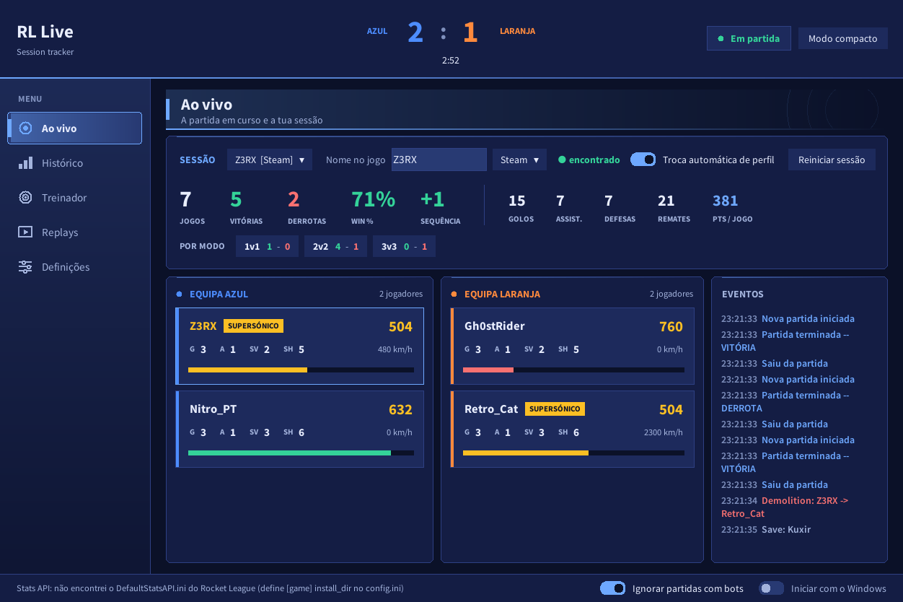
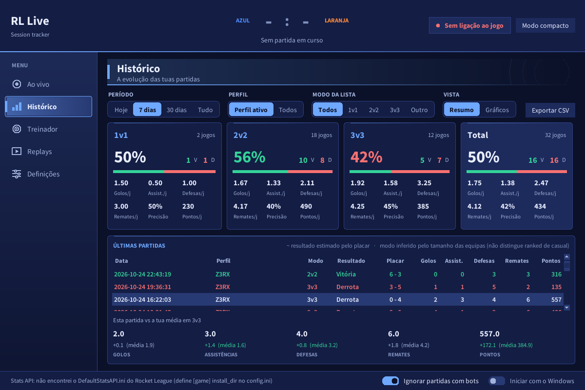
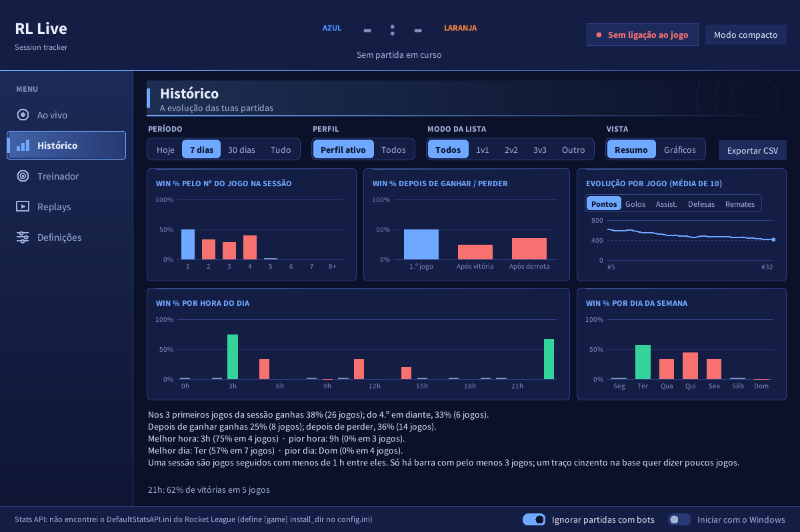
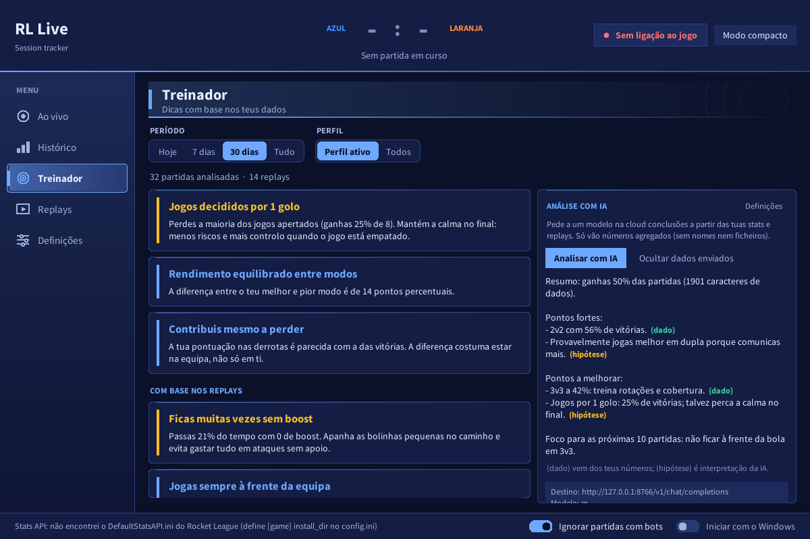
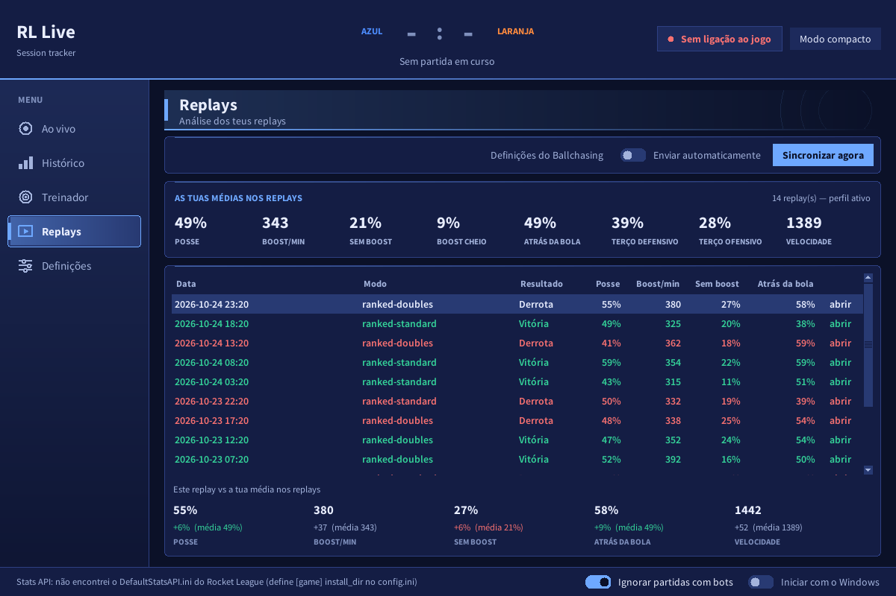
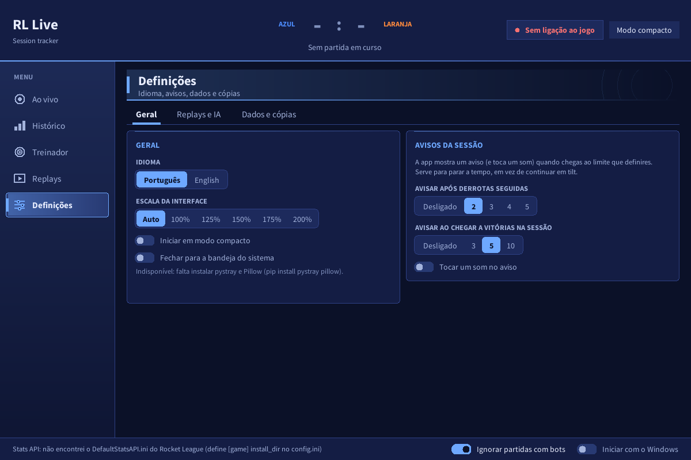

# RL Live Dashboard

Painel para Windows que mostra **em tempo real** o que se passa nas tuas partidas de Rocket League e **guarda o histórico** para veres como estás a evoluir. Funciona com a Stats API oficial do jogo, sem mods nem nada que mexa no jogo.


<sub>Capturas com dados de exemplo.</sub>

**O que faz**

- **Ao vivo:** placar, tempo, jogadores de cada equipa (golos, assistências, defesas, remates, boost, velocidade) e feed de eventos.
- **Sessão:** jogos, vitórias, derrotas, sequência e win%, separados por modo (1v1, 2v2, 3v3).
- **Histórico:** todas as partidas guardadas, com filtros, gráficos e exportação para CSV.
- **Treinador:** dicas automáticas a partir das tuas estatísticas, mais análise opcional com IA.
- **Replays:** envia os teus replays para o [Ballchasing](https://ballchasing.com) e compara cada um com a tua média.
- **Avisos:** alerta (banner e som) quando chegas a N derrotas seguidas, para parares antes de entrares em tilt.
- Português e inglês, escala da interface, ícone na bandeja, cópia de segurança automática.

---

## Índice

1. [Instalação rápida](#1-instalação-rápida)
2. [Primeira configuração](#2-primeira-configuração)
3. [Guia da aplicação](#3-guia-da-aplicação)
4. [Definições](#4-definições)
5. [Os teus dados e privacidade](#5-os-teus-dados-e-privacidade)
6. [Problemas comuns](#6-problemas-comuns)
7. [Como funciona e limitações](#7-como-funciona-e-limitações)
8. [Para programadores](#8-para-programadores)

---

## 1. Instalação rápida

**Requisitos:** Windows 10 ou 11 e o Rocket League instalado (Steam ou Epic). Não precisas de Python.

1. Vai à página de **Releases** deste repositório e descarrega o `RL-Live-Dashboard.exe` (ou o `.zip` com ele).
2. Põe o ficheiro numa pasta tua, por exemplo `Documentos\RL-Live-Dashboard`. **Não o deixes em Transferências ou no ambiente de trabalho:** a app guarda os teus dados na mesma pasta do `.exe`.
3. Faz duplo clique para abrir.

> **Aviso do Windows:** como o executável não é assinado, o Windows pode mostrar "O Windows protegeu o seu PC". Clica em **Mais informações** e depois em **Executar mesmo assim**. Alguns antivírus também desconfiam de programas feitos com PyInstaller. Se tiveres dúvidas, o código está todo neste repositório e podes gerar o exe tu mesmo (secção 8).

Para atualizares, fecha a app (incluindo o ícone da bandeja), substitui o `.exe` pelo novo e abre. Os teus dados ficam intactos, porque estão em ficheiros ao lado do exe.

---

## 2. Primeira configuração

São três passos e só se fazem uma vez.

### 2.1 Ativar a Stats API do jogo

A app precisa que o Rocket League emita as estatísticas. **Isto é feito sozinho:** ao abrir, a app procura o `DefaultStatsAPI.ini` do jogo e, se a configuração faltar, escreve-a e avisa na janela ("Stats API … reparada").

Depois disso, **fecha e volta a abrir o Rocket League**, porque o jogo só lê esse ficheiro no arranque.

Se o jogo estiver num sítio pouco usual e a app disser que não encontra o ficheiro, cria um `config.ini` ao lado do exe:

```ini
[game]
install_dir = D:\Jogos\rocketleague
```

Se o jogo estiver em `Program Files` e a reparação falhar por permissões, abre a app uma vez como administrador.

<details>
<summary>Configurar à mão (se preferires)</summary>

Edita, com o jogo fechado, o ficheiro `<pasta do jogo>\TAGame\Config\DefaultStatsAPI.ini`:

```ini
[TAGame.MatchStatsExporter_TA]
PacketSendRate=10
Port=49123
```

O nome da secção tem de ser exatamente esse. `PacketSendRate` tem de ser maior que 0 (10 a 30 é um bom valor) e `Port` é a porta local (49123 por defeito).

Pastas habituais:
- Steam: `C:\Program Files (x86)\Steam\steamapps\common\rocketleague\TAGame\Config\`
- Epic: `C:\Program Files\Epic Games\rocketleague\TAGame\Config\`
</details>

> Depois de cada atualização do jogo, a Steam/Epic pode repor este ficheiro. A app verifica-o ao abrir e de 30 em 30 segundos (fora de partidas) e repara-o sozinha. Se avisar que reparou, reinicia o jogo.

### 2.2 Dizer à app quem tu és

Na página **Ao vivo**, no cartão **Sessão**:

1. Escreve o teu **nome no jogo**, exatamente como aparece no Rocket League.
2. Escolhe a **plataforma** (Qualquer, Steam ou Epic).

É assim que a app sabe qual dos jogadores és tu, para contar as tuas vitórias e derrotas. Quando está tudo certo aparece "encontrado" a verde durante uma partida.

**Tens duas contas (Steam e Epic)?** Cria um perfil para cada uma no menu de perfis (**+ Novo perfil**). Cada perfil tem a sua própria sessão. Com **Troca automática de perfil** ligada, a app muda sozinha para o perfil certo quando começa uma partida.

### 2.3 Jogar

Abre o Rocket League e entra numa partida (online, treino contra bots, o que quiseres). A app liga-se sozinha: o indicador no topo passa de "Sem ligação ao jogo" a **"Em partida"**. A ligação só existe durante uma partida, por isso no menu principal do jogo aparece "Sem ligação", e isso é normal.

Não precisas de abrir a app depois do jogo: podes tê-la aberta antes, que ela fica à espera.

---

## 3. Guia da aplicação

A navegação está na barra lateral esquerda: **Ao vivo**, **Histórico**, **Treinador**, **Replays** e **Definições**.

O botão **Modo compacto** (canto superior direito) reduz a janela a uma barra pequena com o essencial da sessão, para a deixares num canto do ecrã. **Expandir** volta ao normal.

### Ao vivo


- **Cabeçalho:** placar, tempo restante e estado da ligação.
- **Sessão:** jogos, vitórias, derrotas, win% e sequência (`+3` são três vitórias seguidas, `-2` duas derrotas seguidas), mais os teus totais de golos, assistências, defesas e remates. A linha **Por modo** separa o resultado em 1v1, 2v2 e 3v3.
- **Reiniciar sessão** põe a sessão a zero **sem apagar o histórico**.
- **Equipas:** um cartão por jogador com pontos, golos, assistências, defesas, remates, velocidade e barra de boost. O teu jogador fica destacado.
- **Eventos:** golos, demolições, defesas e fim de partida, em direto.
- Em baixo: **Ignorar partidas com bots** (ligado por defeito) e **Iniciar com o Windows**.

### Histórico



Cada partida contada fica guardada. Os filtros em cima escolhem o **período** (hoje, 7 dias, 30 dias, tudo), o **perfil**, o **modo** e a **vista**:

- **Resumo:** um cartão por modo com jogos, vitórias/derrotas, win%, golos, assistências, defesas e remates por jogo, precisão e pontos, mais a lista das últimas partidas. **Clica numa partida** para a comparares com a tua média (a barra mostra o que ficou acima ou abaixo).
- **Gráficos:** pensados para tirar conclusões, não só para ver números:
  - **Win% pelo nº do jogo na sessão** (1.º, 2.º, 3.º…): mostra se rendes pior à medida que jogas. Uma sessão são jogos seguidos com menos de 1 hora entre eles.
  - **Win% depois de ganhar / depois de perder:** mostra se uma derrota te faz jogar pior a seguir (tilt), comparado com o 1.º jogo da sessão.
  - **Evolução por jogo:** média dos últimos 10 jogos de pontos, golos, assistências, defesas ou remates. Útil para veres se estás a melhorar mesmo quando o win% está parado.
  - **Win% por hora do dia e por dia da semana**, com o melhor e o pior.
- **Exportar CSV** gera um ficheiro que abre direto no Excel.



O sinal `~` ao lado de um resultado significa que foi **estimado pelo placar** (por exemplo, saíste a meio) e pode não coincidir com o resultado oficial. Nos gráficos de barras, uma barra só aparece com pelo menos 3 partidas nesse grupo; com menos, fica um traço cinzento. Por baixo dos gráficos vês frases como "nos 3 primeiros jogos da sessão ganhas 60%; do 4.º em diante, 40%".

### Treinador



Dicas automáticas calculadas a partir das tuas estatísticas (por exemplo, "perdes as partidas decididas por 1 golo" ou, com replays, "gastas muito tempo sem boost"). Funciona **offline e sem configuração**.

Há ainda a **Análise com IA**, opcional:

1. Configura o serviço em **Definições > Replays e IA** (secção 4).
2. Carrega em **Analisar com IA**. A resposta marca cada ponto com **(dado)**, vindo dos teus números, ou **(hipótese)**, interpretação do modelo.
3. **Ver dados enviados** mostra exatamente o que sai da tua máquina antes de enviares: destino, instruções e números. A chave nunca aparece.

### Replays



Envia os replays do jogo para o Ballchasing e guarda as estatísticas deles para análise.

1. Faz uma vez a configuração do Ballchasing (secção 4).
2. No jogo, ativa o **guardar replays automaticamente** nas opções, para os ficheiros existirem.
3. Carrega em **Sincronizar agora**, ou liga **Enviar automaticamente**.

A tabela mostra posse de bola, boost por minuto, tempo sem boost, tempo atrás da bola e velocidade de cada replay. As médias no topo juntam todos eles. Clica numa linha para veres como esse replay se compara com a tua média, e em **abrir** para o veres no site.

### Definições



Ver a secção seguinte.

---

## 4. Definições

Três separadores. As mudanças de **idioma** e **escala** aplicam-se logo, sem reiniciar.

### Geral

| Opção | O que faz |
|---|---|
| Idioma | Português ou English |
| Escala da interface | Auto, 100% a 200%. Útil em ecrãs 4K ou portáteis com zoom |
| Iniciar em modo compacto | Abre já na barra pequena |
| Fechar para a bandeja do sistema | Ao fechar a janela, a app fica no ícone da bandeja (precisa de `pystray` e `pillow`, que já vêm no exe) |
| Avisar após derrotas seguidas | Desligado ou 2, 3, 4, 5 |
| Avisar ao chegar a vitórias na sessão | Desligado ou 3, 5, 10 |
| Tocar um som no aviso | Liga/desliga o som |

Os avisos só contam partidas depois de abrires a app: ao arrancar não dispara nenhum.

### Replays e IA

**Ballchasing**

1. Cria conta em [ballchasing.com](https://ballchasing.com) e vai a [ballchasing.com/upload](https://ballchasing.com/upload) para copiar a tua **chave de API**.
2. Cola-a no campo e carrega em **Testar**.
3. **Pastas dos replays:** por defeito é `Documentos\My Games\Rocket League\TAGame\Demos`. Podes adicionar outras com **+ Adicionar pasta**.
4. **Visibilidade no Ballchasing:** Privado, Não listado ou Público.
5. **Enviar replays:** só os novos, dos últimos 7 dias, dos últimos 30 dias ou todos.

**Análise com IA**

A app fala com qualquer serviço compatível com a API da OpenAI.

1. Escolhe o **serviço** (Groq, Google Gemini, OpenRouter ou Outro) e cria uma chave de API no site dele. Vê aí o plano gratuito e os modelos disponíveis.
2. Cola a **chave**. O **modelo** vem sugerido e podes mudá-lo.
3. Com **Outro** indicas tu o **endereço** base (`.../v1`), por exemplo o de um modelo local no teu PC.
4. Escolhe a **língua da resposta** (igual à da app, Português, English ou Español).

### MMR

<a id="mmr"></a>

Mostra o teu MMR de 1v1, 2v2 e 3v3 no **Histórico → MMR** (atual, variação de hoje e dos 7 dias, melhor valor, gráfico e quanto ganhas/perdes em média por vitória/derrota). Há duas maneiras de o registar:

- **À mão:** no **Ao vivo** (ou no Histórico → MMR) escolhe o modo, escreve o número que vês no jogo e carrega em **Guardar MMR**.
- **Automático (opcional):** a app consulta o teu perfil público numa API de terceiros ([Rocket League na RapidAPI](https://rapidapi.com/TonyKun7/api/rocket-league10)). Não toca no jogo nem no anti-cheat.
  1. Cria conta na RapidAPI e subscreve o plano **Basic** (grátis, 10 pedidos por dia; pede cartão mas não cobra).
  2. Copia a tua chave (`x-rapidapi-key`) para **Definições → MMR** e carrega em **Testar**.
  3. Na **Epic** o nome do perfil da app serve (o teu nome no jogo). Na **Steam** a API pede o **custom URL** do perfil (a parte de `steamcommunity.com/id/…`): cola-o, ou o link inteiro, no campo **Identificador para o MMR** do perfil ativo. O nome do perfil da app continua a ser o do jogo.
  4. A app gasta **1 pedido ao abrir**, **1 no fim da sessão** (10 minutos sem jogar, ao reiniciar a sessão ou ao fechar a app) e **1 sempre que carregas em Atualizar do jogo**. O contador no **Ao vivo** mostra os pedidos usados hoje (o plano grátis tem 10 por dia, por conta). Em **Consultar também durante a sessão** podes escolher uma consulta extra a cada 30 min, 1 h ou 2 h (só se houve jogos desde a última); por omissão fica em **Só no fim da sessão**.

O MMR pode demorar alguns minutos a refletir o último jogo, e a API é de um autor individual (pode ficar lenta ou mudar). Cada pessoa usa a sua própria chave. O ganho/perda médio por jogo só conta intervalos entre dois registos com **exatamente um jogo** (precisos 3 de cada), por isso com consultas só no início e no fim da sessão serve sobretudo o registo manual depois de cada jogo.

### Dados e cópias

- Lista os ficheiros de dados e o tamanho de cada um.
- **Abrir pasta** abre a pasta onde estão.
- **Exportar dados…** cria um `.zip` com os teus dados, **sem as chaves de API**, útil para mudares de PC.
- **Cópia automática:** uma cópia por dia, ao abrir a app, numa pasta à tua escolha, e apaga as mais antigas (guarda 3, 7, 14 ou 30). **Fazer cópia agora** força uma.

---

## 5. Os teus dados e privacidade

Tudo é guardado **no teu PC, na pasta do `.exe`**:

| Ficheiro | Conteúdo |
|---|---|
| `profiles.json` | Os teus perfis e as sessões |
| `history.db` | Histórico de partidas |
| `replays.db` | Estatísticas dos replays analisados |
| `settings.json` | Definições da app |
| `ballchasing.json` | Chave do Ballchasing e opções |
| `rlapi.json` | Chave da API do MMR, contador de pedidos diários e opções |
| `ai.json` | Chave e opções do serviço de IA |
| `config.ini` | Opcional: pasta do jogo |
| `backups\` | Cópias automáticas (sem chaves) |

- **As chaves de API ficam em texto simples** nos ficheiros `ballchasing.json`, `ai.json` e `rlapi.json`. Nunca os partilhes. As cópias automáticas e a exportação **não os incluem**.
- **A app não envia nada para fora** sem o pedires. Só fala com a internet quando usas o Ballchasing (envia os replays) ou a análise com IA.
- **IA:** só vão **números agregados** (vitórias, médias por modo, etc.), nunca nomes de jogadores nem ficheiros. Confirma sempre com **Ver dados enviados**.
- Para desinstalar, apaga a pasta. Não há instalador nem registo no Windows, a não ser que ligues **Iniciar com o Windows**, que cria uma entrada de arranque (desligar o interruptor remove-a).

---

## 6. Problemas comuns

**Fica em "Sem ligação ao jogo".**
É normal fora de uma partida. Se também não liga durante uma partida: confirma que reiniciaste o Rocket League depois de a app ter configurado a Stats API (secção 2.1) e que a porta 49123 não está ocupada por outro programa.

**"Stats API: não encontrei o DefaultStatsAPI.ini".**
A app não achou a pasta do jogo. Define-a no `config.ini` (secção 2.1).

**A partida não conta para a sessão.**
Por defeito não contam: treino livre (sem adversários) e partidas com bots (desliga **Ignorar partidas com bots** se quiseres contá-las). Também não contam partidas em que saíste antes de haver placar útil. O feed de eventos explica o motivo.

**Não me reconhece / "encontrado" não aparece.**
Escreve o nome exatamente como no jogo (maiúsculas e minúsculas não importam, mas sufixos e símbolos sim) e escolhe a plataforma certa.

**A app não abre uma segunda vez.**
Só pode haver uma instância. Se já está aberta, aparece uma mensagem ou a janela é trazida para a frente. Procura-a na **bandeja do sistema**.

**O Windows/antivírus bloqueia o exe.**
Ver o aviso na secção 1. Podes gerar o exe tu mesmo (secção 8).

**Ballchasing diz "chave inválida".**
Copia a chave outra vez de [ballchasing.com/upload](https://ballchasing.com/upload), sem espaços, e carrega em **Testar**.

**Quero recomeçar do zero.**
Fecha a app e apaga `history.db` e `profiles.json`. Faz antes uma cópia ou uma exportação.

---

## 7. Como funciona e limitações

A Stats API do Rocket League é um **socket TCP local** (`127.0.0.1:49123`) que envia objetos JSON, não um WebSocket verdadeiro. A app liga-se com um socket TCP simples e separa as mensagens concatenadas contando as chavetas.

**Limitações da API oficial**

- Só emite dados **durante uma partida** no teu PC e só dos jogadores dessa partida.
- **A Stats API do jogo não dá MMR nem rank.** A app obtém o teu MMR por fora: escreves tu (campo MMR no **Ao vivo** ou no **Histórico → MMR**) ou ela consulta o teu perfil público numa API de terceiros (RapidAPI, ver [MMR automático](#mmr)). Esta app **não mexe no processo do jogo** (nada de injeção ou mods), para não entrar em conflito com o anti-cheat.
- **Não diz a playlist.** O modo (1v1, 2v2, 3v3) é inferido pelo tamanho das equipas, por isso **não distingue ranked de casual** nem separa Hoops/Rumble.

**Como se decide vitória ou derrota**, por esta ordem:

1. **`MatchEnded`**, em que o próprio jogo anuncia a equipa vencedora. É o caso normal.
2. **Rede de segurança:** se esse evento não chegar, usa o último estado conhecido (`bHasWinner`/`Winner`) quando saís da partida.
3. **Estimativa pelo placar:** se saíres antes de haver vencedor, usa o último placar. Fica marcado com `~` no histórico e "ESTIMATIVA pelo placar" no feed, porque **pode estar errado**.

Se nem isso for possível, a partida não é contada.

---

## 8. Para programadores

### Correr a partir do código

Precisas de Python 3 recente (testado com 3.12) com Tkinter, que vem com o instalador oficial no Windows.

```bash
python app.py
```

O `app.py` só usa a biblioteca padrão. O ícone da bandeja é opcional (`pip install pystray pillow`).

### Gerar o .exe

No Windows, na pasta do projeto:

```bash
build.bat
```

Cria um ambiente virtual, instala o `requirements.txt` (PyInstaller, pystray, pillow), apaga builds antigas e gera `dist\RL-Live-Dashboard.exe` com as fontes incluídas. **Não apaga os teus dados** em `dist\`: faz cópia deles para `dados_backup\` antes de gerar. Se o `.exe` antigo estiver aberto ou bloqueado, fecha-o primeiro.

### Testes

```bash
pip install -r requirements-dev.txt
python -m pytest
```

Os testes cobrem a lógica de sessão, histórico, perfis, Ballchasing, IA (com servidores simulados), gráficos, cópias e traduções (verificam que todos os textos têm tradução em inglês).

### Estrutura

| Ficheiro | Para que serve |
|---|---|
| `app.py` | Janela principal, navegação, avisos, bandeja |
| `tracker_core.py` | Ligação à Stats API, estado e sessão (sem GUI) |
| `stats_api_config.py` | Deteta o jogo e repara o `DefaultStatsAPI.ini` |
| `profiles.py` | Perfis Steam/Epic e troca automática |
| `history.py`, `history_page.py` | Histórico em SQLite e respetiva página |
| `charts.py`, `compare.py` | Gráficos e comparação com a média |
| `coach.py`, `coach_page.py`, `ai_coach.py` | Dicas offline e análise com IA |
| `ballchasing.py`, `replays_page.py` | Replays e Ballchasing |
| `settings_page.py`, `appsettings.py` | Definições |
| `maintenance.py` | Cópias, exportação e instância única |
| `tray.py` | Ícone da bandeja |
| `ui_kit.py` | Tema e componentes (cartões, menus, abas, fontes) |
| `i18n.py`, `i18n_en.py` | Traduções |
| `rl_session_tracker.py` | Versão simples em linha de comandos |
| `fonts/` | Fontes incluídas no exe |
| `tests/` | Testes automáticos |

### Traduções

Os textos no código estão em português e servem de chave. Usa `tr("texto")` e acrescenta a tradução ao dicionário `EN` em `i18n_en.py`. Se faltar uma chave, aparece o português (e o teste avisa).

### Ferramenta de linha de comandos

```bash
python rl_session_tracker.py --player "OTeuNome" --csv sessao.csv --log eventos.jsonl
```

Outras opções: `--live` (ecrã de texto que se atualiza), `--verbose`, `--port`.

### Contribuir

Os dados e as chaves estão no `.gitignore` (`profiles.json`, `settings.json`, `ballchasing.json`, `ai.json`, `rlapi.json`, `*.db`, `backups/`, `dist/`). Confirma com `git status` antes de cada commit que nenhum aparece.

---

## Créditos

- Stats API: [Psyonix / Rocket League](https://www.rocketleague.com/developer/stats-api).
- Replays: [Ballchasing](https://ballchasing.com).
- Fonte: [Source Sans Pro](https://github.com/adobe-fonts/source-sans) (Adobe), licença SIL OFL (ver `fonts/LICENSE-SourceSans.txt`).

Este projeto não é afiliado nem apoiado pela Psyonix ou pela Epic Games. Rocket League é uma marca registada da Psyonix.
